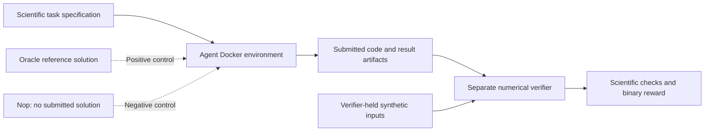

# 🌍 GeoClimateBench

**Reproducible Earth-science coding benchmarks | Scientific Python | AI-agent evaluation**

[](https://github.com/AisunZa/GeoClimateBench/actions/workflows/ci.yml)
[](pyproject.toml)
[](docs/DATA_SOURCES.md)

**GeoClimateBench** is an open-source scientific Python portfolio project that turns climate-data processing workflows into **terminal-based coding tasks with independently checked numerical results**. It tests whether a submitted program handles physical units, timestamps, geographic coordinates, missing observations, statistics, and scientific reporting correctly—not merely whether it runs or produces convincing plots.

The project provides **three self-contained scientific tasks**, **three Docker-based Harbor benchmarks**, and a **separate optional real-data validation task**. The offline benchmarks use synthetic inputs; the optional ERA5-Land/DWD Berlin study uses separately acquired real data. This is a portfolio and learning project, not an official Harbor or Terminal-Bench submission, a secure hidden-test platform, or a published climate study.

**Start here:** [Benchmark results](#verified-benchmark-results) · [How evaluation works](#how-the-benchmark-evaluation-works) · [Run it locally](#quick-start) · [Scientific methodology](docs/METHODOLOGY.md) · [Data sources and limitations](docs/DATA_SOURCES.md)

## Verified benchmark results

The following **Harbor 0.24.0** controls were observed locally; the scientific regression workflow also completed successfully on GitHub-hosted infrastructure.

| Harbor benchmark | Oracle control | Nop control | Scientific regression controls |
|---|---:|---:|---|
| [01 — Daily Temperature QC](benchmarks/daily-max-qc/) | **1.0** | **0.0** | **5/5** fault-injection checks |
| [02 — Heatwave P90](benchmarks/heatwave-p90/) | **1.0** | **0.0** | **12/12** fault-injection checks |
| [03 — Station–Grid Validation](benchmarks/station-grid-validation/) | **1.0** | **0.0** | **4/4** unseen fixtures, **20/20** invalid-input checks, **6/6** deliberate-error detections |

**Additional evidence:** **32/32** original scientific regression tests passed locally. The GitHub Actions `scientific-fault-injection` job passed for commit [`37307f5`](https://github.com/AisunZa/GeoClimateBench/commit/37307f59da30564a61b37ad56bced807b27de9ca): **[view successful CI run](https://github.com/AisunZa/GeoClimateBench/actions/runs/39966344276)**.

**How to interpret these results:** An **Oracle** run executes the supplied reference solution (positive control); a **Nop** run submits no solution (negative control). These scores verify basic benchmark operation; they are **not** independent AI-agent pass rates. The checks exercise specific scientific cases, not all possible inputs. The benchmark data are **synthetic**, so these numbers are **not** real-world model-accuracy or forecasting-skill results.

## How the benchmark evaluation works

The benchmark task specifies an interface, supplies controlled input data and scientific libraries, and asks a coding agent to write a program. A **separate verifier environment** reconstructs expected scientific outputs without importing the submitted program as its numerical oracle.



For [Station–Grid Validation](benchmarks/station-grid-validation/instruction.md), the agent must implement a reusable CLI:

```text
python /app/solve.py --daily INPUT.nc --stations INPUT.csv --output-dir OUTPUT_DIRECTORY
```

It must submit `/app/solve.py`, `/app/results/station_pairs.csv`, and `/app/results/metrics.json`. The independent verifier checks Haversine matching, ordered exclusions, model-minus-observation errors, station-level and global metrics, and output schemas. It then reruns the submitted code against four unseen valid datasets and 20 invalid input cases. Six deliberate errors additionally test that the verifier rejects scientifically wrong outputs.

The supplied Benchmark 03 fixture contains **156 artificial station records**, giving **120 valid pairs** and **36 exclusions**. All stations must appear in summaries—even stations with zero valid pairs, whose undefined error statistics must be JSON `null`.

**Isolation and threat model:** Agent and verifier Docker images are separate, and the verifier's reference inputs are its own copies. Verifier source is public; this is transparent numerical evaluation, **not tamperproof or secret grading**. The GitHub Actions scientific-regression job tests benchmark behavior using known reference implementations; the independent Harbor Oracle/Nop runs are separate evaluations.

## Scientific tasks

| Task | Scientific challenge | Output | Key checks |
|---|---|---|---|
| [01 — Hourly QC and daily maximum](tasks/task-01-daily-max/instruction.md) | Validate hourly 2 m temperature in Kelvin, mask invalid values, require at least 18 valid hours per UTC day and grid cell, convert to sampled daily maximum °C | `daily_max.nc` | Units, timestamps, coverage, temperature bounds, dimensions |
| [02 — Historical P90 heatwaves](tasks/task-02-heatwave-detection/instruction.md) | Compute 1991–2020 day-specific p90 with ±7 calendar days; identify episodes of at least five consecutive *strict* exceedance days | `heatwaves.nc` | Percentile method, 300 samples, 20 years, missing dates, run boundaries |
| [03 — Station–grid validation](tasks/task-03-station-validation/instruction.md) | Match daily station-like observations to the nearest grid cell using Haversine distance; report exclusions, bias, MAE, and RMSE | `station_pairs.csv`, `metrics.json` | Coordinates, 180 km limit, valid outliers, signed errors |
| [04 — Optional real-data case](tasks/task-04-real-berlin-validation/instruction.md) | Compare separately obtained July 2022 ERA5-Land hourly temperatures against DWD Berlin-Tempelhof station daily maxima | Daily maxima, station pairs, metrics, provenance | Source QC, observation-day convention, original archive, SHA-256 hashes |

**Scientific distinction:** Task 01 computes the maximum of *sampled hourly values*, not the continuously recorded maximum. A point station and a model grid cell can also differ because of elevation, exposure, and spatial representativeness. Task 02's 1991–2020 reference period and five-day definition are explicit **operational choices**, not universal definitions of a heatwave.

### Core numerical conventions

- **Temperature units:** Require Kelvin for hourly `t2m`; convert with `°C = K − 273.15`. Accept finite hourly temperatures from 180 through 340 K, masking invalid measurements rather than treating them as extremes.
- **Daily completeness:** Require at least 18 quality-controlled hourly samples for a sampled UTC daily maximum. Keep missing days/cells missing; no fabricated gap filling.
- **Climatology:** For each July 2022 day and grid cell, calculate the 90th percentile from 1991–2020 values in a ±7-day calendar window; require at least 300 finite values from at least 20 distinct baseline years.
- **Heatwaves:** Use a *strictly greater than* threshold test and mark every day in an episode of at least five consecutive exceedance days; missing data and date gaps break an episode.
- **Spatial matching:** Find the overall nearest grid cell using great-circle (Haversine) distance and spherical Earth radius 6371.0088 km. The synthetic Task 03 benchmark uses a 180 km cutoff and **does not interpolate**.
- **Comparison statistics:** Error is `modeled − observed`. Report signed bias, mean absolute error (MAE), root mean squared error (RMSE), and maximum absolute error; retain valid high-error observations rather than silently discarding outliers.
- **Numerical verification:** Use explicit absolute tolerance `1e-4` and relative tolerance `0`, independent calculations, and fault-detection controls.

Details, edge cases, and known limitations are in [METHODOLOGY.md](docs/METHODOLOGY.md) and [LIMITATIONS.md](docs/LIMITATIONS.md).

## Quick start

The scientific demo and local test suite need **Python 3.10+** and installed dependencies. The commands below use **Windows Anaconda PowerShell** from the repository root. The demo runs offline *after dependencies have been installed* and needs no CDS API key or real observational data.

```powershell
# Create a project virtual environment if you do not already have one.
python -m venv .venv

# Install GeoClimateBench with development/test dependencies.
.\.venv\Scripts\python.exe -m pip install -e ".[dev]"

# Run the original scientific regression suite.
.\.venv\Scripts\python.exe -m pytest -q

# Generate synthetic data, execute the scientific pipeline, and verify outputs.
.\.venv\Scripts\python.exe -m geoclimatebench demo --data-dir data --output results
```

The offline demo writes `results/daily_max.nc`, `results/heatwaves.nc`, `results/station_pairs.csv`, `results/metrics.json`, `results/run_metadata.json`, and two sample PNG plots (`heatwave_days.png`, `heatwave_timeseries.png`). They are **synthetic outputs**, not measurements from ERA5-Land or DWD.

Run individual stages with `python -m geoclimatebench solve-task --task 1|2|3` and `python -m geoclimatebench grade-task --task 1|2|3`; use `--data-dir` and `--output` as needed. See the [task specifications](tasks/) for details.

### Reproduce the Harbor controls

Requires **Harbor 0.24.0**, a working Docker Desktop/WSL2 setup on Windows, and the scientific dependencies available inside the Docker images. Docker image builds may need network access for uncached base images or packages; the benchmark execution environments have network disabled.

```powershell
# From the repository root, with Docker Desktop running:
harbor run -p ".\benchmarks\daily-max-qc" -a oracle
harbor run -p ".\benchmarks\daily-max-qc" -a nop
harbor run -p ".\benchmarks\heatwave-p90" -a oracle
harbor run -p ".\benchmarks\heatwave-p90" -a nop
harbor run -p ".\benchmarks\station-grid-validation" -a oracle
harbor run -p ".\benchmarks\station-grid-validation" -a nop
```

An independent coding agent would be evaluated separately from these Oracle/Nop controls. Local exploratory Qwen2.5-Coder 3B / Terminus 2 experiments and their limitations are described in [LOCAL_MODEL_EVALUATION.md](docs/LOCAL_MODEL_EVALUATION.md); two single-trial agent runs received 0.0 and do **not** establish a population pass rate. A separately corrected human-assisted implementation is not an independent model success.

### Reproduce scientific fault-detection tests

Build the verifier images before running the first two fault-injection scripts. These commands test the verifier with known correct and deliberately incorrect implementations; they do **not** rerun an AI model.

```powershell
docker build -t geoclimatebench-qc-verifier .\benchmarks\daily-max-qc\tests
docker build -t geoclimatebench-heatwave-verifier .\benchmarks\heatwave-p90\tests

.\.venv\Scripts\python.exe .\benchmarks\daily-max-qc\fault_injection.py
.\.venv\Scripts\python.exe .\benchmarks\heatwave-p90\fault_injection.py

.\.venv\Scripts\python.exe .\benchmarks\station-grid-validation\tests\regression_cases.py `
    --solver .\benchmarks\station-grid-validation\solution\solve_station.py `
    --verifier .\benchmarks\station-grid-validation\tests\verify.py `
    --workers 2
```

The [GitHub Actions Harbor verifier workflow](.github/workflows/harbor-verifier-regression.yml) also builds the required verifier images and runs all three scientific-control suites in Linux. The separate [scientific-validation workflow](.github/workflows/ci.yml) runs the original pytest/demo checks on Python 3.10, 3.11, and 3.12.

## Optional real-world ERA5-Land / DWD validation

Real observational and reanalysis datasets are **not distributed with this repository**. To reproduce the optional [Berlin-Tempelhof, July 2022 case study](tasks/task-04-real-berlin-validation/instruction.md), obtain the appropriate hourly [ERA5-Land](https://cds.climate.copernicus.eu/datasets/reanalysis-era5-land) and original daily [DWD CDC](https://opendata.dwd.de/climate_environment/CDC/observations_germany/climate/daily/kl/historical/) files separately, respecting their licensing and data-use terms.

The Task 04 verifier independently recomputes 31 sampled UTC daily maxima, nearest-cell matching, errors, and summary metrics. It checks station metadata and DWD `QN_4` quality-flag information, as well as SHA-256 source-file provenance. The 2022-applicable Berlin-Tempelhof station metadata indicate a nominal **00:00–24:00 UTC** observation day; do not assert that a different calendar-day window explains the observed bias in this case.

The exploratory one-station/one-month results previously observed were **bias −1.438 °C, MAE 1.525 °C, RMSE 1.728 °C**. These values illustrate one narrowly scoped historical comparison; they are **not** general ERA5-Land accuracy or forecast-skill estimates.

```powershell
# After independently acquiring, normalizing, and auditing the real input data:
.\.venv\Scripts\python.exe scripts\compare_real_july2022.py
.\.venv\Scripts\python.exe scripts\grade_real_july2022.py
```

For acquisition, normalization, real-data station-coordinate checks, and caveats, see [DATA_SOURCES.md](docs/DATA_SOURCES.md), [TASK04_VALIDATION.md](docs/TASK04_VALIDATION.md), and the [Task 04 instructions](tasks/task-04-real-berlin-validation/instruction.md). The standard `grade` / `grade-task` commands validate the **official synthetic fixtures**, not real-data authenticity.

## Repository guide

```text
GeoClimateBench/
├── geoclimatebench/                 # Scientific pipeline, CLI, fixtures, readers, plots
│   ├── science.py                  # QC, daily maxima, climatology, heatwaves
│   ├── validation.py               # Station-grid comparisons and error metrics
│   ├── era5.py / dwd.py            # Optional source-format adapters
│   ├── evaluate.py                 # Original offline numerical grader
│   └── cli.py                      # Command-line interface
├── tasks/                           # Three scientific tasks + optional real-data Task 04
├── benchmarks/                      # Three standalone Harbor benchmark packages
│   ├── daily-max-qc/
│   ├── heatwave-p90/
│   └── station-grid-validation/
├── tests/                           # Original scientific unit and regression tests
├── docs/                            # Methods, provenance, limitations, evaluation notes
├── example_results/                 # Precomputed SYNTHETIC outputs
├── .github/workflows/              # pytest/demo CI and scientific verifier CI
├── Dockerfile                       # Original scientific demo environment
└── pyproject.toml                   # Python project configuration
```

## Reproducibility and scientific integrity

- **Synthetic versus real:** All three Harbor benchmarks and the default demo use generated datasets. Real data are separate, optional, and source-audited.
- **Interpretation:** Synthetic pass/fail results demonstrate behavior on controlled scientific problems, not broad meteorological validity or general AI-model capability.
- **Verification:** Reference solutions, public independent verifiers, and fault-detection tests are included so reviewers can inspect assumptions and reproduce checks. Public tests are not secure hidden evaluations.
- **Human review:** This portfolio/learning project was developed with AI assistance. Scientific and technical claims require human understanding, re-execution, and review; a human-assisted repair is never labeled as an independent AI-agent success.
- **Licensing:** The MIT license applies to original repository code, not automatically to externally downloaded ERA5-Land/DWD products; follow source-specific terms.

## Roadmap

- Improve the documentation of the existing real ERA5-Land/DWD case study, then broaden observational coverage only after auditing metadata, quality flags, and time conventions.
- Add spatial/temporal sensitivity analyses and uncertainty assessments with independently testable numerical claims.
- Consider harder multi-stage Earth-science coding tasks when they contribute new scientific reasoning rather than duplicating existing benchmarks.
- Quantify AI-agent success rates only with a controlled, repeatable evaluation protocol and a sufficient set of independent trials.

**Current validated milestone:** Three Harbor benchmarks, successful local Oracle/Nop controls, 17 fault-injection checks for Benchmarks 01–02, 30 scientific controls for Benchmark 03, 32 passing original scientific tests, and a [successful GitHub-hosted scientific-regression run](https://github.com/AisunZa/GeoClimateBench/actions/runs/39966344276). These claims refer to the tested feature-branch implementation and should be rechecked after future code changes.
